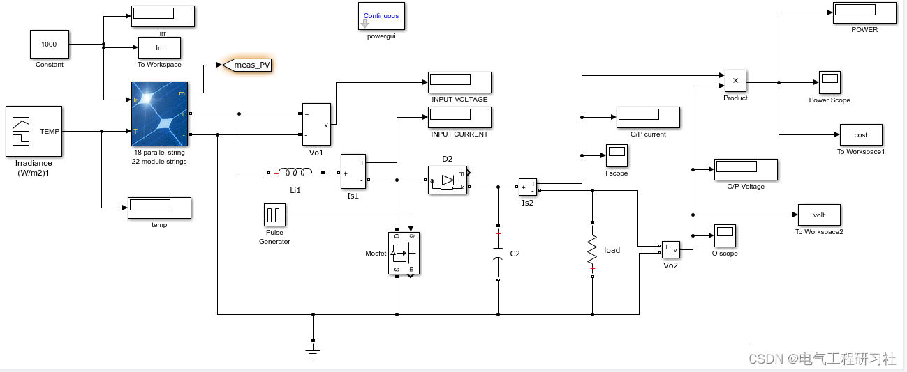
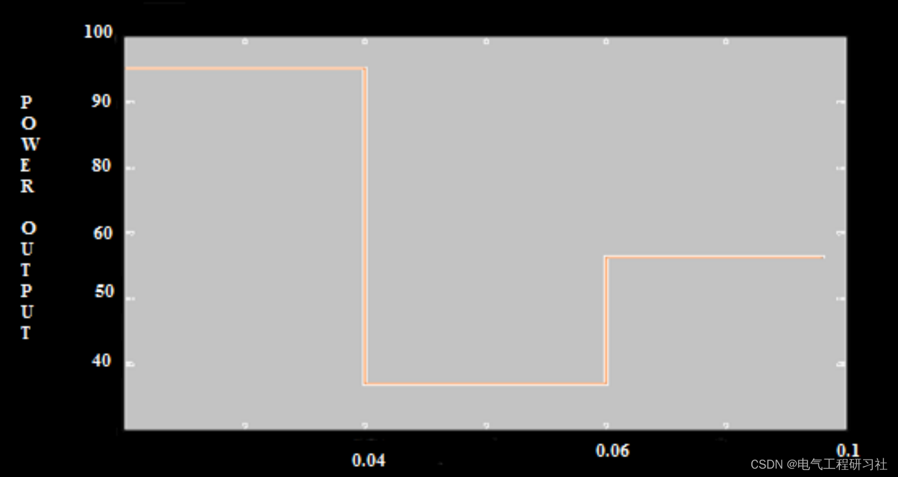
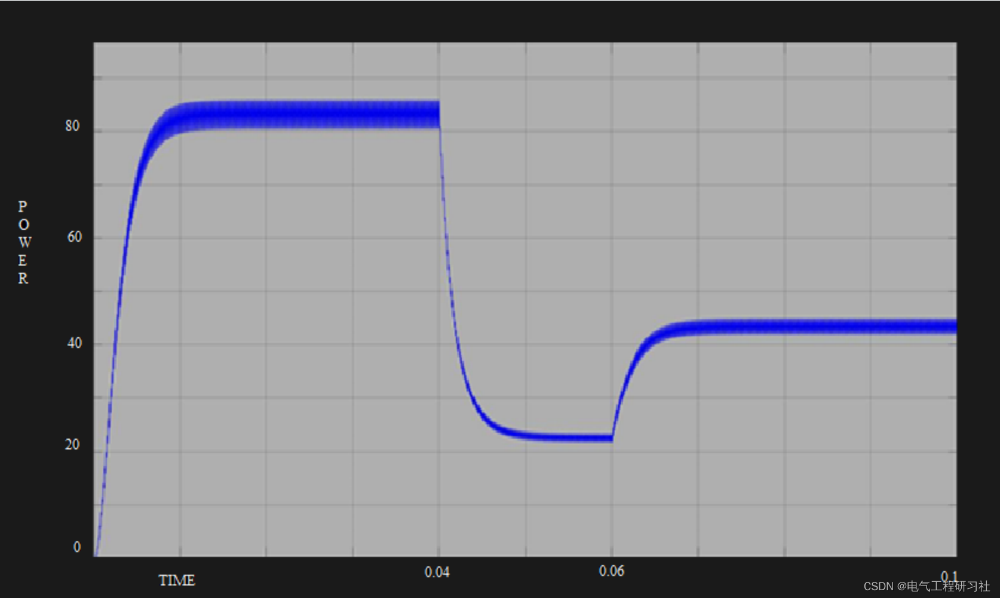

# Matlab|Based on Particle Swarm Optimization Algorithm and Robust MPPT Controller to Enhance the Efficiency of Photovoltaic Grid-Connected Systems

​  
💥💥💥💞💞💞💞 Welcome to this blog❤️❤️❤️💥💥💥
📋📋📋This article is organized as follows: ⛳️⛳️⛳️Table of Contents: 1. Photovoltaic Characteristics 2. Motivation 3. Particle Swarm Optimization-Based MPPT Algorithm 4. Simulink Model and MATLAB Code 5. Conclusion 6. Final Thoughts
The characteristics of photovoltaic cells are nonlinear, and their output power varies with the irradiance and temperature. The nonlinearity is due to the fact that the values of illumination and temperature vary throughout the day, thereby reducing the output efficiency. Furthermore, the efficiency of these photovoltaic modules does not meet the power demand. Therefore, it is necessary to design an algorithm to improve the efficiency of photovoltaic modules to address the difference between battery efficiency and power demand. Therefore, the goal of this paper is to design and establish the relevant models, then improve the efficiency of photovoltaic systems based on particle swarm optimization algorithm and auxiliary MPPT algorithm.
2. Motivation Currently, most street lights are powered by conventional energy sources. However, there is a significant gap between the growing demand and the available resources. Consequently, there is an increasing demand for renewable energy, specifically solar street lights.
Solar power supply devices are best suited for areas with scarce renewable resources. These solar power supply devices have a higher initial cost. Therefore, it is necessary to integrate a robust MPPT controller. The maximum power point tracking (MPPT) consists of extracting the maximum power from photovoltaic power generators. With MPPT, more devices can be powered with less energy.
3. MPPT Algorithm Based on Particle Swarm Optimization
Step 1 (Parameter selection): In the proposed system, particle positions are defined by the duty cycle value d of the DC-DC converter, and the fitness function is selected as the generated power P. From an algorithmic perspective, even in complex shadow modes, more particles lead to more accurate MPP tracking. However, more particles also result in longer computation times. Therefore, a balance must be struck to ensure good tracking speed and accuracy.
Step 2 (PSO Initialization): During the PSO initialization phase, particles can be placed at fixed positions or randomly distributed within the space. Generally, it is more meaningful to initialize the surrounding particles around the Global _ MPP if there is information about its position in the search space. This paper initializes the particles at fixed positions within a uniformly distributed search space [Dmin, Dmax].
Step 3 (Fitness Evaluation): The objective of the proposed MPPT algorithm is to maximize the generated power PPV. After the digital controller outputs, based on the PWM command (representing the duty cycle command) of particle i's position, VPV and IPV can be measured. Then, these values are used to calculate the fitness value PPV for particle i. It should be noted that to obtain correct samples, the time interval between consecutive particle evaluations must be greater than the stable time of the power converter.
Step 4 (Update individual and global best data): If the fitness value of particle i is better than the historical best fitness value p_(best,i), then the current value is set as the new p_(best,i). Then, all particles with the best fitness value are selected as g_best. This step is similar to the standard PSO method's step 3.
Step 5 (Update each particle's velocity and position): After evaluating all particles, the velocity and position of each particle in the population should be updated.
Step 6 (Convergence determination): This paper uses two convergence criteria. If all particle velocities are less than a threshold or the maximum number of iterations is reached, the proposed MPPT algorithm will stop and output the obtained g_best solution.
Step 7 (Re-initialization): Typically, PSO methods are used to solve problems where the optimal solution is time-invariant. However, in this application, the fitness (Global Maximum Available Power) often changes with environmental conditions and load conditions. In such cases, it is necessary to re-initialize particles to search for new GMPP again. The following constraints are used to detect shade changes and sunshade mode changes.
4 Simulink Model and MATLAB Code Editing
Editing
Editing
All models are packed here:
Editing
5 Conclusion
The purpose of this paper is to improve the efficiency of photovoltaic modules. The characteristics of photovoltaic cells are nonlinear, and their output power varies with the irradiance and temperature changes. A DC-DC Boost converter is designed to boost the voltage from 16 ~ 21v solar panels to the voltage required for device power supply. Then, a DC-DC Boost converter was designed to increase the output voltage, finding suitable values for inductors and capacitors. To verify the stability of the circuit, a modeling of the DC-DC Boost converter was conducted.
Particle Swarm Optimization (PSO) assisted MPPT algorithm was used to enhance the efficiency of photovoltaic modules. The implementation of PSO technology was demonstrated, showing an increase in output power. This method was tested under different atmospheric conditions. Research found that even under partial shading and varying atmospheric conditions, the PSO method can quickly and accurately track MPP.
6 End Note - Theory References and Network Citations
Editing
Editing
In conclusion, please note that any theoretical references or network citations should be removed if they infringe upon copyright.

## Images

<!-- PAYMENT_BLOCK -->

## Get this dataset

- Payment link (Stripe): [Buy now](https://buy.stripe.com/3cs8yP7sY87d0vu9AB)
- Payment QR code: 

<!-- /PAYMENT_BLOCK -->
